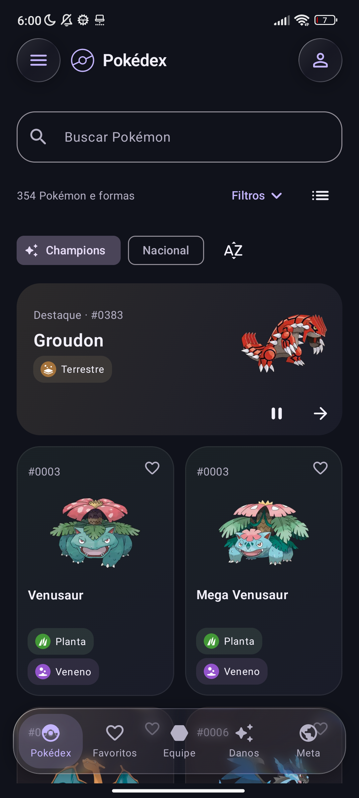
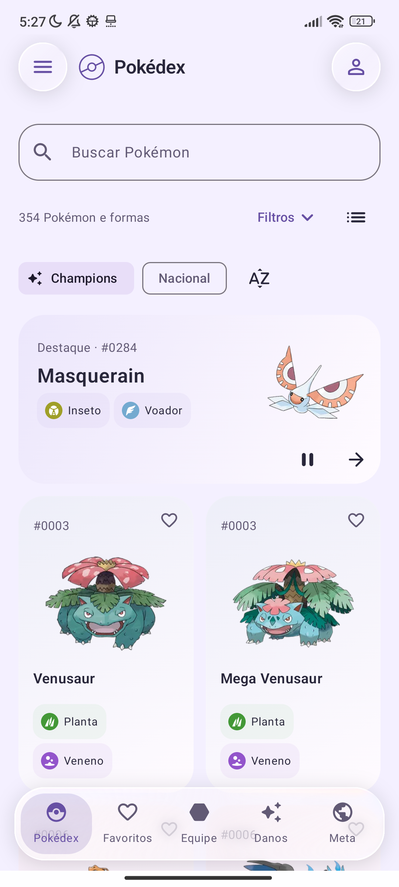

<p align="center"></p>

# PrismaDex

**Pokédex, equipes e cálculo de dano para Pokémon Champions.**

O PrismaDex é o segundo app da **[Aizen Visuals](https://github.com/AizenVisuals)**, depois do [Halo Calc](https://github.com/AizenVisuals/bloody-calc). A proposta é reunir consulta e preparação de equipes em um Android nativo, com identidade própria, temas e controles de vidro.

Catálogo, artes, golpes, favoritos, equipes e calculadora funcionam offline desde a instalação. A aba Meta usa internet para consultar relatórios e mantém a última consulta em cache.

**[Baixar PrismaDex 0.4.1 — prévia Android](https://github.com/AizenVisuals/prismadex/releases/tag/v0.4.1-preview)** · [Novidades](CHANGELOG.md) · [Privacidade](PRIVACY.md)

## No seu celular

<p align="center">


</p>

Capturas reais em Redmi Note 10S com Android 13: tema escuro na versão 0.4.1 e tema claro na 0.4.0.

## O que você encontra

- **Pokédex:** busca por nome/número, grade ou lista, filtros por tipo, geração e jogo, favoritos e destaque rotativo, incluindo lendários.
- **Champions e Nacional:** 1.025 espécies nacionais em 1.306 registros com formas. A seleção Champions revisada reúne 231 espécies em 354 registros; veja os [limites das fontes](docs/DADOS.md).
- **Fichas completas:** arte local, tipagens com símbolos, atributos, habilidades e golpes do jogo selecionado.
- **TeamBuilder:** múltiplas equipes com jogo e formato próprios. Em Champions, configure habilidade, natureza, SP, item e até quatro golpes.
- **Rascunhos locais:** alterações no set ficam separadas do set salvo; sair do editor oferece salvar, descartar ou continuar.
- **Calculadora offline:** Singles e Doubles, sets de equipes diferentes e alvos de teste independentes, condições de batalha, intervalo de dano e chance de KO.
- **Meta online:** relatórios mensais separados por formato, com fonte e período explícitos. Dados do simulador não são apresentados como ranking oficial do jogo.
- **Aparência:** Aurora, Carmim, Oceano, Jade, Âmbar e Pérola; cada paleta tem claro, escuro e opção Sistema. Vidro com refração no Android 13+, transições e resposta ao toque.

## Instalar e atualizar

1. Abra a [release de prévia](https://github.com/AizenVisuals/prismadex/releases/tag/v0.4.1-preview).
2. Baixe `PrismaDex-0.4.1-preview.apk`.
3. Abra no Android e autorize a instalação pelo navegador ou gerenciador de arquivos quando solicitado.

Requer **Android 8 ou superior**. A distribuição atual é de teste, pelo GitHub; não é uma publicação na Play Store. O APK usa assinatura de desenvolvimento. Atualize por cima da instalação anterior quando a assinatura for a mesma; desinstalar ou limpar dados pode apagar suas equipes.

A conta por e-mail/senha desta versão existe **somente neste aparelho**. Ainda não há sincronização em nuvem, confirmação de e-mail ou recuperação remota. O modo visitante também funciona offline.

## Estado do projeto

PrismaDex está em desenvolvimento. Outros jogos permitem planejamento por catálogo/golpes; treinamento histórico e itens específicos ainda estão incompletos. A seleção Champions e o motor são versionados; nem toda regra competitiva de equipe ou cenário está validada.

A versão 0.4.0 passou por build, lint e 18 testes instrumentados no Redmi, além de verificação de rascunho após reiniciar o app, tema claro e texto ampliado. A 0.4.1 corrigiu o alinhamento da grade, com inspeção no mesmo aparelho em fonte normal e ampliada. Isso não estabelece paridade integral com outras ferramentas nem desempenho universal. [Validação e limitações](docs/VALIDACAO.md).

## Compilar

Código principal em `android/`: **Kotlin + Jetpack Compose + Material 3**, sem WebView. Requer **JDK 17** e Android SDK com plataforma **35**.

```sh
cd android
# Configure ANDROID_HOME ou crie local.properties com sdk.dir.
./gradlew :app:assemblePreview :app:lintDebug
# Com aparelho/emulador conectado:
./gradlew :app:connectedDebugAndroidTest
```

O APK local fica em `android/app/build/outputs/apk/preview/`. Builds locais/CI podem usar certificados de desenvolvimento diferentes do APK distribuído; não os trate como atualizações assinadas pela Aizen Visuals.

O GitHub Actions verifica build e lint e compila a suíte instrumentada. Ele não publica APKs automaticamente: os arquivos das Releases são builds validados, mantendo controle sobre a assinatura. A suíte instrumentada precisa de Android real ou emulador para ser executada.

## Créditos e licença

Código desta implementação sob **GPL-3.0**, com avisos e licenças próprios preservados para componentes de terceiros. [Licença](LICENSE) · [Créditos técnicos](android/THIRD_PARTY_NOTICES.md) · [Fontes dos dados](docs/DADOS.md).

PrismaDex é um projeto de fã independente da Aizen Visuals, sem afiliação com The Pokémon Company, Nintendo, Game Freak ou Creatures. Personagens, marcas, artes e demais conteúdos Pokémon pertencem aos respectivos titulares e não são relicenciados pela licença do código.

**Aizen Visuals** · [Halo Calc](https://github.com/AizenVisuals/bloody-calc) · [PrismaDex](https://github.com/AizenVisuals/prismadex)
